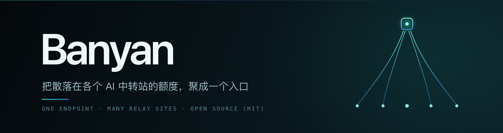

<div align="center">



**把散落在各个 AI 中转站的额度，聚成一个入口**

[](#许可)
[](https://nodejs.org)
[](https://www.typescriptlang.org)

[功能](#功能) · [与上游的区别](#与上游-metapi-的区别) · [快速开始](#快速开始) · [常见问题](#常见问题)

</div>

---

> [!IMPORTANT]
> **Banyan 是 [metapi](https://github.com/cita-777/metapi) 的破坏性 fork，不与上游保持兼容。**
>
> 它在 metapi 基础上把 anyrouter / agentrouter 的 `login` / `verifyToken` /
> `getBalance` / `checkin` 从纯 HTTP 改成转发给一个**真浏览器后端**，
> 用来通过阿里云 ESA 的新版 JS 挑战。
>
> **部署前必读**
>
> - 本 fork **多一个外部依赖**：[`checkin-backend/`](./checkin-backend/)，必须另外部署
>   （真浏览器 + xvfb + 可选代理）。不部署它，添加账号 / 签到 / 余额刷新会全部失效，
>   症状是「Token verification timed out」这类难查的超时。完整步骤见
>   [`checkin-backend/README.md`](./checkin-backend/README.md)。
> - 其余站点的 Go 支持不受影响 —— 你完全可以只用 Banyan 的上游功能。
> - 界面里部分文案、内部标识（localStorage 键、备份文件名）仍沿用上游的 `metapi`
>   命名，改动它们会破坏已有用户的配置与备份兼容性，故有意保留。
> - **托管平台（Render / Zeabur 等）部署不了完整形态**：容器内起不了 xvfb 和真浏览器，
>   也访问不到你主机上的 `checkin-backend`，因此在那里只能使用非 anyrouter 站点。

## 名字

**Banyan** 是榕树。榕树一棵主干垂下无数气生根，根须各自扎地成干 —— 独木成林。
这正是这个项目在做的事：一个入口，接住散落在各处的站点。

## 与上游 metapi 的区别

### 为什么要 fork

metapi 对接 anyrouter / agentrouter 时，`login` / `verifyToken` / `checkin` /
`getBalance` 全都走纯 HTTP。而这两个站前面挂着阿里云 ESA，下发的是
`aliyun_waf_aa` / `aliyun_waf_bb` 那套**新版 JS 挑战 —— 必须执行页面脚本才能通过**。
上游 `newApiShield.ts` 里那套 `node:vm` 求解只认老的 `var arg1` + `acw_sc__v2` 形式，
对新挑战无效。实测症状：

| 症状 | 真实原因 |
|---|---|
| 添加账号报 `Token verification timed out (10s)` | `verifyToken` 拿到的是挑战页 HTML，不是 JSON |
| 添加账号报 `This site is shielded by anti-bot challenge` | `login` 走纯 HTTP POST，过不了挑战 |
| 签到间歇失败 `Unexpected token '<'` | 同上，响应是挑战页 |
| 面板上余额一直不动 | `getBalance` 静默失败 |

所以这些方法被改成转发给一个**外部浏览器能力后端**（CloakBrowser 真浏览器 + 代理），
由它把挑战解掉再请求接口。

### 具体改了什么

核心改动是在 adapter 层做替换，**不改任何调用点** —— 全仓库 6 处调用
（`checkinService` / `balanceService` / `manualAccountCreationService` /
`accounts` 路由）因此一次性全部获得真浏览器能力，API 契约与前端一行都不用动。

| # | 改动 | 说明 |
|---|---|---|
| 1 | `anyrouter.ts` 重写 5 个方法 | 转发到浏览器后端；`getBalance` 不再吞异常（否则会把 0 当真实余额写库） |
| 2 | `platformUserId` 不再靠猜 | 上游从用户名末尾抓数字，注册邮箱形式的用户名抓不到 → 401「未提供 New-Api-User」→ 余额恒为 0 |
| 3 | 自动重登写回 ID | 原本只写回 `accessToken`，重登拿到的新 ID 会丢，下次照样 401 |
| 4 | 超时放宽 | 真浏览器过挑战单次 12-90 秒是常态，硬编码的 10s/30s 必然超时 |
| 5 | 调度默认值降频 | 每次调用都真起一个浏览器，高频请求会让出口 IP 被 ESA 拉黑（见下） |
| 6 | 删除 `pnpm-lock.yaml` | 上游带来的死文件，导致 Dependabot 的 npm 生态任务每次都失败，安全告警 PR 收不到 |

> [!WARNING]
> **不要调高调度频率。** 2026-09-02 实测：默认的每小时刷余额 + 6 小时签到，
> 约 60 次/天全部来自同一个出口 IP，结果阿里云 ESA 把该 IP 拉黑，
> **全站**（含首页）返回 403。降频到每天 2 次余额 + 12 小时间隔后降到约 8 次/天。
> 签到奖励一天只发一份，刷得再勤也拿不到第二份。

完整的技术细节、架构说明与踩坑记录见 [`LOCAL_FORK.md`](./LOCAL_FORK.md)。

## 架构

```
你的客户端（OpenAI / Claude 兼容）
        │  一个 API Key
        ▼
┌───────────────────────────────────────────────┐
│  Banyan（面板 / 连接管理 / 调度 / 路由 / 日志）  │
│                                               │
│  NewApiAdapter ──> New API / One API / ...    │
│  AnyRouterAdapter ──HTTP RPC──┐               │
└───────────────────────────────┼───────────────┘
                                ▼
              checkin-backend（真浏览器 + xvfb + 代理）
                    127.0.0.1:4100/__checkin/ext/*
                    └─ 解掉 JS 挑战，再请求站点接口
```

后端**故意做成无状态**：调度、连接管理、签到日志、消息推送全部由 Banyan 负责，
避免两套系统各推一份通知、各记一份日志。

## 功能

除上面的浏览器后端外，Banyan 保留 metapi 的全部能力：

- **多站点聚合** — New API / One API / OneHub / DoneHub / Veloera / AnyRouter / Sub2API
  等，统一成一个 OpenAI / Claude 兼容入口
- **自动发现模型 + 智能路由** — 按可用性与成本择优
- **账号与令牌管理** — 多账号、分组、自动重登、余额与额度监控
- **自动签到** — 定时任务 + 签到日志 + 奖励记录
- **消息推送** — Webhook / Bark / ServerChan / Telegram 等
- **代理日志** — 上下游请求追踪，方便排查
- **自托管** — 数据存本地 SQLite（也支持 MySQL / Postgres），不向第三方发送
- **桌面应用** — 也可作为 Electron 应用运行

界面与 API 的详细说明请看[上游文档站](https://metapi.cita777.me) —— 注意其内容描述的是
**上游版本**，不包含本 fork 的 anyrouter 改动。

> [!NOTE]
> 本 fork 额外带一个可选的 Telegram 管理机器人（签到推送 + 命令交互 + 代理看门狗），
> 见 [`checkin-backend/README.md`](./checkin-backend/README.md)。

## 快速开始

### 只想要上游功能（不用 anyrouter / agentrouter）

按上游方式部署即可：

```bash
git clone https://github.com/Jacky1n7/banyan.git
cd banyan
cp .env.example .env && chmod 600 .env
# 必须改：AUTH_TOKEN（面板登录）、PROXY_TOKEN（下游调用）
docker compose -f docker/docker-compose.yml up -d --build
```

或直接 `npm ci && npm run build && npm start`（需要 Node.js 22.15+）。

### 要用 anyrouter / agentrouter（需要浏览器后端）

多一步：按 [`checkin-backend/README.md`](./checkin-backend/README.md) 部署浏览器后端，
然后在 Banyan 的 compose 里接上：

```yaml
services:
  banyan:
    extra_hosts:
      - "host.docker.internal:host-gateway"
    environment:
      EXT_WAF_URL: http://host.docker.internal:4100/__checkin/ext
      EXT_WAF_TIMEOUT_MS: "240000"
```

加账号时**站点的 `platform` 必须填 `anyrouter`**（agentrouter 也填这个，
adapter 按 URL 分辨具体是哪个站）。

### 升级

本 fork 用 `local-fork` 分支维护，**不要依赖上游的更新中心** ——
它的版本检查与默认镜像都指向上游，跟着更新会把 fork 的改动覆盖掉
（见「已知限制」）。

```bash
git pull && docker compose -f docker/docker-compose.yml up -d --build
```

## 常见问题

**Q：不用 anyrouter，这个 fork 和上游有区别吗？**
基本没有，除了调度默认值更保守、修了几个上游的 ID 解析 bug、CI 能正常跑。
你可以只把它当"修过 bug 的 metapi"用。

**Q：为什么必须单独部署浏览器后端？**
因为过 WAF 挑战需要真浏览器执行 JS。它依赖
[millylee/anyrouter-check-in](https://github.com/millylee/anyrouter-check-in) 的
登录与 cookie 获取逻辑，所以那些文件必须放在该项目的 clone 目录里运行。

**Q：我的出口 IP 被拉黑了（全站 403，`via` 头带 `403102`）怎么办？**
换出口节点。这是 IP 级封禁，不是指纹问题 —— 实测同一时刻家用宽带能正常拿到挑战页，
而被拉黑的服务器两条出口都是硬 403。恢复后**不要调高调度频率**。

**Q：更新中心提示有新版，能点吗？**
不要。更新中心的版本检查和默认镜像目前指向上游仓库，跟着更新会覆盖掉本 fork 的改动。
这是已知限制，见下。

## 已知限制

- **更新中心指向上游** — `updateCenterVersionService.ts` 检查的是上游 releases，
  `updateCenterConfigService.ts` 默认拉 `1467078763/metapi` 镜像。想用更新中心的话，
  需要在设置里改成你自己的镜像仓库。
- **托管平台只能跑简化形态** — 见顶部提示。
- **`platform` 只认 `anyrouter`** — 填 `new-api` 会掉回纯 HTTP 实现，anyrouter 相关功能失效。
- **界面存在上游残留命名** — 部分描述文案与内部标识仍是 `metapi`，属有意保留（见顶部提示）。
- **文档站内容来自上游** — 不含本 fork 的 anyrouter 改动说明，那部分看 `LOCAL_FORK.md`。

## 许可

[MIT](./LICENSE) —— 与上游一致。

本项目是 [cita-777/metapi](https://github.com/cita-777/metapi) 的 fork，
浏览器后端依赖 [millylee/anyrouter-check-in](https://github.com/millylee/anyrouter-check-in)
与 [CloakBrowser](https://pypi.org/project/cloakbrowser/)。感谢上游作者与贡献者。

---

<div align="center">
<sub>使用前请自行确认目标站点的服务条款。自动签到与绕过反爬可能违反站点规定，风险自负。</sub>
</div>
